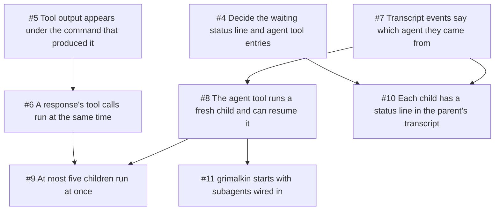

## Goal

Give the model a built-in way to delegate a task to a child agent and get
back only the conclusion, with several children running at once. De-risks the
core change everything else in subagents builds on: tool calls running
concurrently, a second turn loop per child, and cancellation reaching every
child.

## Demo

In grimalkin, ask "use two subagents to summarise `internal/core` and
`internal/adapters`": two status lines run at the same time, and the parent
answers from the `[agent 1]` and `[agent 2]` replies. Asking the model to
resume `agent: 9` comes back as an unknown-agent error, and a child's attempt
to start a subagent is refused.

## Implements

- Subagents spec, Implementation Decisions: the `agent` tool (`task` and
  `agent`; `model` and `fork` come in #3), children are agents, fresh
  children and their own tool list, concurrent tool calls with skill calls
  first, the cap of five, numbering and lifetime, and cancelling the parent's
  turn.
- Subagents spec, Ports: transcript events tagged with their agent, and the
  child lifecycle events behind the status lines.

## Out of scope

- Buffers, `:ls`, `:b N`, `gf`, follow-ups typed into a child, and Ctrl-C on
  one child (goes to #2).
- Choosing another model, the `subagents` config block, and fork (goes to
  #3).

## Open in this slice

- What a child's status line shows while it waits for one of the five slots.
  Recorded in: the subagents spec.
- Whether `agent` calls also get the usual tool started/finished entries in
  the parent's transcript, or only the status line. Recorded in: the
  subagents spec.

## Tasks
- [ ] #4 Decide the waiting status line and agent tool entries
- [ ] #5 Tool output appears under the command that produced it
- [ ] #6 A response's tool calls run at the same time (after #5)
- [ ] #7 Transcript events say which agent they came from
- [ ] #8 The agent tool runs a fresh child and can resume it (after #7)
- [ ] #9 At most five children run at once (after #6, #8)
- [ ] #10 Each child has a status line in the parent's transcript (after #4, #7)
- [ ] #11 grimalkin starts with subagents wired in (after #8)

Can start now: #4, #5, #7

