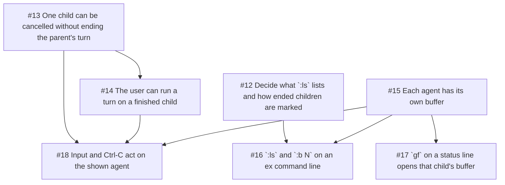

## Goal

Let the user go into a subagent: watch it work, read what it did, talk to it
afterwards, and stop it alone. This is the feature on top of ordinary
subagents, and it de-risks the TUI moving from one transcript to one per
agent, plus the first piece of the ex command line.

## Demo

During a turn that started subagents, `:ls` lists them and `:b 1` (or `gf`
on a status line) opens that child's live transcript. Once it has finished, a
follow-up typed there is answered in its buffer; Enter does nothing while it
is still running. Ctrl-C in a running child's buffer stops only that child,
the parent reports it as "cancelled by user" and carries on, and the child's
buffer stays, marked as cancelled.

## Implements

- Subagents spec, Implementation Decisions: TUI buffers, and cancelling one
  child.
- Subagents spec, Solution: subagents as buffers.

## Out of scope

- The `agent` tool, concurrency and status lines (goes to #1).
- Another model, fork, and a status bar showing a child's model (goes to #3;
  until then every child shows the parent's).
- Steering a running child mid-turn (wishlist #11).
- Splits; buffers are full screen.

## Open in this slice

None. The subagents spec (TUI buffers, and turns the user starts on a child)
settles `:ls`, the parent's buffer, and how a user's turn counts.

## Tasks
- [x] #12 Decide what `:ls` lists and how ended children are marked
- [x] #13 One child can be cancelled without ending the parent's turn
- [x] #14 The user can run a turn on a finished child (after #13)
- [x] #15 Each agent has its own buffer
- [x] #16 `:ls` and `:b N` on an ex command line (after #12, #15)
- [x] #17 `gf` on a status line opens that child's buffer (after #15)
- [x] #18 Input and Ctrl-C act on the shown agent (after #13, #14, #15)

Can start now: none; every task is done

