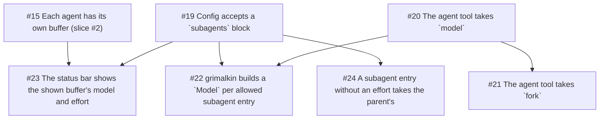

## Goal

Let a subagent run on any model the user allows, on any configured provider,
and let the model fork a child from the current conversation. De-risks
running several providers in one session (keys resolved up front, one
`Model` per allowed entry) and fork keeping the parent's cache and thinking
valid.

## Demo

With a `subagents` block allowing Ollama `glm-5.3-flash:cloud`, asking for a
subagent on glm-flash runs one whose status line and buffer show glm-flash. A
fork on the parent's model starts from the parent's conversation, and its
first request reads the parent's cached prefix. `fork: true` with glm-flash
is rejected, and a `subagents` entry naming a model the provider doesn't
declare stops grimalkin at startup with a config error.

## Implements

- Subagents spec, Implementation Decisions: the `model` and `fork`
  parameters and their rejected combinations, forks, config, and the port
  giving the core a `Model` per allowed entry.
- Subagents spec, Solution: mixed fleet.

## Out of scope

- Forking onto a model other than the parent's.
- Choosing a child's tools in the config file.
- Named agent types with their own prompts and tools.

## Open in this slice

None. The spec settles the config shape, the parameter rules and how a fork
is built, including how its history ends.

## Tasks
- [x] #19 Config accepts a `subagents` block
- [x] #20 The agent tool takes `model`
- [x] #21 The agent tool takes `fork` (after #20)
- [x] #22 grimalkin builds a `Model` per allowed subagent entry (after #19, #20)
- [x] #23 The status bar shows the shown buffer's model and effort (after #15, #19)
- [ ] #24 A subagent entry without an effort takes the parent's (after #19)

Can start now: #24

